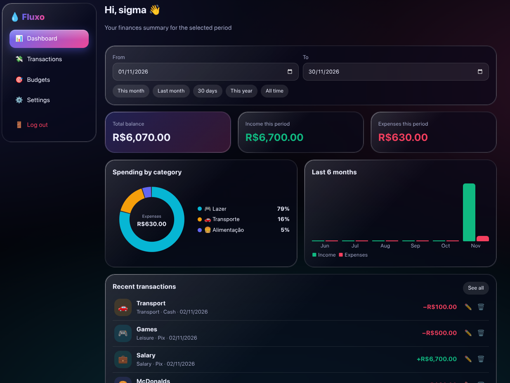

<!-- Fluxo README -->

<div align="center">

  <h1>💧 Fluxo</h1>
  <p><strong>A simple, beautiful way to stay on top of your personal finances.</strong></p>

  <p>
    
  </p>

  <p>
    
    
    
    
    
  </p>

  <p>
    <a href="#-features">Features</a> ·
    <a href="#-getting-started">Getting started</a> ·
    <a href="#-tech-stack">Tech stack</a> ·
    <a href="#-data-and-privacy">Data & privacy</a>
  </p>

</div>

---

## ✨ About

**Fluxo** is a lightweight personal finance tracker built with vanilla HTML, CSS, and JavaScript. It helps you organize your income and expenses, keep an eye on your budget, and understand where your money goes — all through a clean, responsive interface.

No frameworks, no complicated setup. Just open the app and take control of your finances.

## 🚀 Features

- **Dashboard** — Get an overview of your total balance, income, and expenses.
- **Transactions** — Add, edit, delete, and search through financial records.
- **Categories** — Organize transactions with built-in or custom categories.
- **Budgets** — Set monthly spending limits and get warnings when you approach or exceed them.
- **Recurring transactions** — Schedule weekly, monthly, or yearly entries.
- **Visual reports** — Explore spending breakdowns and income/expense charts.
- **Personalization** — Customize accent colors, wallpapers, and animations.
- **Language options** — Switch the app's display language.
- **Local accounts** — Create an account and keep separate data in your browser.

## 🧰 Tech stack

| Technology | Purpose |
| --- | --- |
| HTML5 | App structure |
| CSS3 | Styling, responsive layout, animations, and visual effects |
| Vanilla JavaScript | App logic, interactions, and data handling |
| Local Storage | Saving data in the browser |

## 🏁 Getting started

Fluxo does not require a build step or package installation.

1. Clone this repository:

   ```bash
   git clone https://github.com/sigmadev21/fluxo.git
   ```

2. Open the project folder.
3. Open `index.html` in your browser.

That's it! You're ready to go.

## 🔐 Data and privacy

Fluxo currently stores account information and financial data locally in your browser using **Local Storage**.

- Your data stays in the browser where you use the app.
- Data is not automatically synchronized between devices or browsers.
- Clearing the browser's site data may erase your Fluxo information.

**Tip:** Keep your own backup of important information.

## 🗺️ Project structure

```text
fluxo/
├── img/
│   └── img1.png
├── index.html
└── README.md
```

## 🤝 Contributing

Suggestions, bug reports, and contributions are welcome!

If you find a bug or have an idea to improve Fluxo, feel free to open an issue or submit a pull request.

## 📄 License

No license has been specified for this project yet.

---

<div align="center">
  Made with 💜 by <a href="https://github.com/sigmadev21">sigmadev21</a>
</div>
